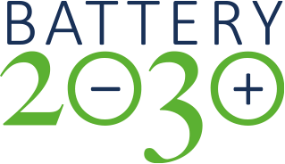
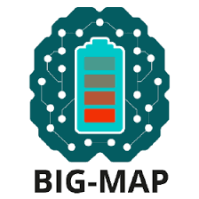

# AiiDA Yambo  

This is the official repository containing the AiiDA plugin and workflows for Yambo.

## Documentation

The documentation for this package can be found on Read the Docs at https://aiida-yambo.readthedocs.io/en/latest
[](https://aiida-yambo.readthedocs.io/en/master/?badge=master)

## Installation instructions:

Requirements: Python >=3.10 and AiiDA (>=2.4.1,<3); the other python packages are listed in `pyproject.toml`.

Installation via pip

```
pip install -e yambo-aiida
```

**Note on `yambopy`**: the plugin needs the `aiida-parsing` branch of `yambopy`, which is installed directly from
GitHub (`yambopy @ git+https://github.com/mikibonacci/yambopy@aiida-parsing`). For this reason the package cannot be
uploaded to PyPI until that branch is released as a regular `yambopy` version.

To run the tests: `pip install -e "yambo-aiida[tests]"` and `pytest tests`.

# Tutorials:
You can find tutorials at the documentation webpage (see above). These 
are both in script-based version (examples/examples_hBN folder) and (jupyter-) notebook-based 
version (examples/examples_Silicon folder).

# License  
The terms of the yambo-aiida license can be found in the LICENSE.txt file.

[](https://github.com/yambo-code/yambo-aiida/actions/workflows/ci.yml)

# Acknowledgements

This work was supported by: the Centre of Excellence "MaX - Materials Design at the Exascale" funded by European Union 
(H2020-EINFRA-2015-1, Grant No. 676598; H2020-INFRAEDI-2018-1, Grant No. 824143; HORIZON-EUROHPC-JU-2021-COE-1 , 
Grant No. 101093374); the European Union's Horizon 2020 research and innovation programme 
(BIG-MAP, Grant No. 957189, also part of the BATTERY 2030+ initiative, Grant No. 957213); 
NCCR MARVEL, a National Centre of Competence in Research, funded by the Swiss National Science 
Foundation (Grant No. 205602).


 

  